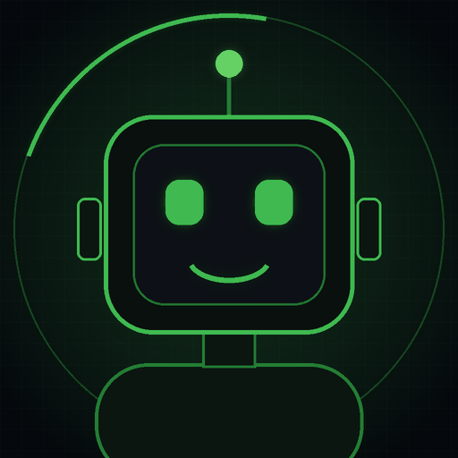

<div align="center">


<br><br>


<br><br>



</div>

<br>

```bash
zakhar@kursk:~$ whoami
> студент, который учится делать ИИ

zakhar@kursk:~$ cat now.txt
> C++       — с нуля, шаг за шагом
> Python    — уверенно двигаюсь вперёд
> ИИ        — курс Samsung IT Academy
> проект    — вместе с наставником из Samsung

zakhar@kursk:~$ echo $GOAL
> стать инженером в области искусственного интеллекта

zakhar@kursk:~$ _
```

<br>

## 🧭 Чем занимаюсь сейчас

- 🎓 Учусь на **ФФМИ КГУ**: информатика и вычислительная техника, профиль ИИС
- 🤖 Прохожу курс по **искусственному интеллекту** в IT Академии Samsung
- 🧱 Изучаю **C++** с нуля
- 🐍 Развиваю **Python**, с которым познакомился при подготовке к ЕГЭ
- 🚀 Делаю проект **ЗерноСкан** в рамках Samsung IT Academy вместе с преподавателем

<br>

## 🛠 Стек

<div align="center">


</div>

<br>

| Технология | Где я сейчас | Прогресс |
|:--|:--|:--|
| 🐍 Python | базовый уровень, развиваю | `███░░░░░░░` |
| ⚙️ C++ | изучаю с нуля | `█░░░░░░░░░` |
| 🧠 ИИ и ML | начинаю путь | `█░░░░░░░░░` |
| 🔀 Git и GitHub | осваиваю | `██░░░░░░░░` |

> Полоски честные: я только в начале пути, и это нормально. Буду обновлять их по мере роста.

<br>

## 📦 Проекты

| Проект | Описание | Статус |
|:--|:--|:--|
| 🌾 **ЗерноСкан** | Проект Samsung IT Academy, делаю вместе с преподавателем | 🚧 в разработке |
| 🔜 Дальше | Учебные работы по C++, Python и ИИ | скоро здесь |

> Раздел растёт вместе со мной: всё, что я делаю, будет появляться здесь.

<br>

## 📈 Активность

<div align="center">

<picture>
  <source media="(prefers-color-scheme: dark)" srcset="https://raw.githubusercontent.com/zahargold063-eng/zahargold063-eng/output/github-snake-dark.svg" />
  
</picture>

<br>


</div>

<br>

<div align="center">


<br><br>

<sub>⭐ Если понравился профиль, заглядывай позже: здесь будет много нового</sub>

</div>


